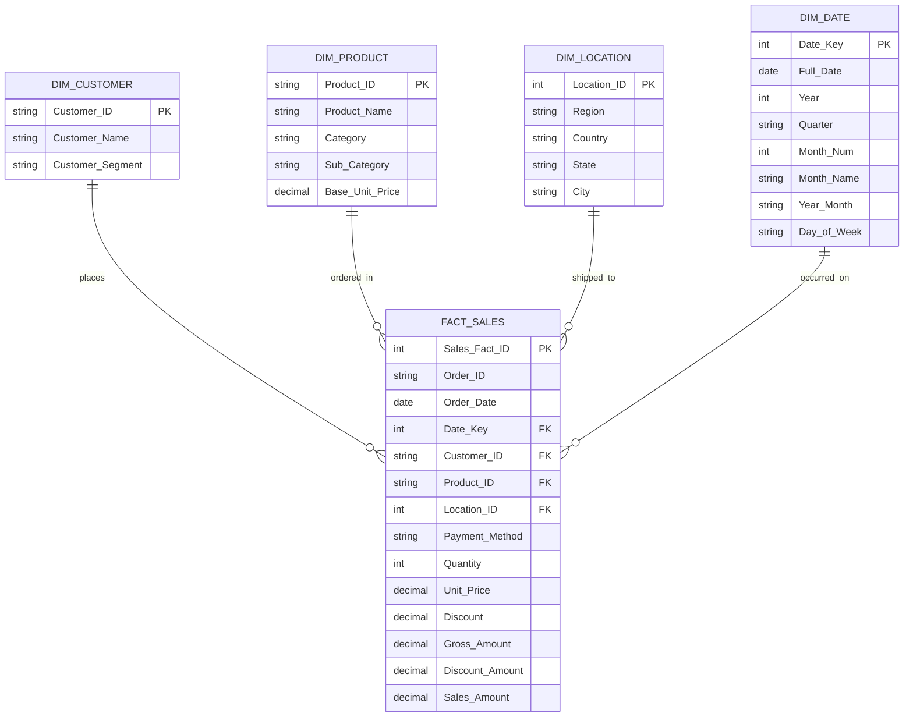

# 📚 Sales Performance Dashboard — Data Dictionary

## 1. Overview
This document defines the schema, data types, business definitions, and validation rules for all fields in the **Sales Performance & Retail Analytics Data Pipeline**.

---

## 2. Cleaned Sales Dataset Schema (`cleaned_sales_data.csv`)

| Column Name | Business Definition | Source / Raw Name | Cleaned Data Type | Example Value | Validation & Constraints |
| :--- | :--- | :--- | :--- | :--- | :--- |
| **`Order_ID`** | Unique alphanumeric transaction identifier | `Order ID` | `VARCHAR(30)` | `ORD-2023-10023` | Not Null, Unique in cleaned data |
| **`Order_Date`** | Calendar date when the order was placed | `Order Date` | `DATE (YYYY-MM-DD)` | `2023-04-18` | Standardized ISO 8601, 2023-2024 |
| **`Product_ID`** | Unique stock keeping unit (SKU) code | `Product ID` | `VARCHAR(30)` | `TEC-LAP-002` | Foreign key to Product Catalog |
| **`Product_Name`** | Commercial product title | `Product Name` | `VARCHAR(150)` | `Apple MacBook Pro 14` | Cleaned of whitespace |
| **`Category`** | High-level product classification | `Category` | `VARCHAR(50)` | `Technology` | Values: `Technology`, `Furniture`, `Office Supplies` |
| **`Sub_Category`** | Granular product sub-classification | `Sub-Category` | `VARCHAR(50)` | `Laptops` | e.g., `Laptops`, `Chairs`, `Storage` |
| **`Quantity`** | Number of physical units purchased | `Quantity` | `INTEGER` | `2` | Must be an integer >= 1 |
| **`Unit_Price`** | Base price per individual unit before discount | `Unit Price` | `DECIMAL(10,2)` | `1999.00` | Greater than $0.00 |
| **`Discount`** | Promotional discount percentage | `Discount` | `DECIMAL(5,2)` | `0.10` | Bounded between 0.00 and 0.20 |
| **`Gross_Amount`** | Total sale value before discounts ($Quantity \times Unit\_Price$) | Engineered | `DECIMAL(12,2)` | `3998.00` | Must equal $Quantity \times Unit\_Price$ |
| **`Discount_Amount`** | Dollar savings deducted from sale ($Gross \times Discount$) | Engineered | `DECIMAL(12,2)` | `399.80` | Non-negative |
| **`Sales_Amount`** | Net revenue recognized by the business ($Gross - Discount$) | `Sales Amount` | `DECIMAL(12,2)` | `3598.20` | Key metric for all financial KPIs |
| **`Customer_ID`** | Unique identifier for registered buyer | `Customer ID` | `VARCHAR(30)` | `CUST-1042` | Not Null, links to customer history |
| **`Customer_Name`** | Full name of the customer | `Customer Name` | `VARCHAR(100)` | `Sophia Brown` | Imputed from Customer_ID if null |
| **`Customer_Segment`** | Business market segment of the buyer | `Customer Segment` | `VARCHAR(50)` | `Corporate` | Values: `Consumer`, `Corporate`, `Home Office` |
| **`Region`** | Geographic sales territory | `Region` | `VARCHAR(50)` | `West` | Values: `Central`, `East`, `South`, `West` |
| **`Country`** | Nation where order was delivered | `Country` | `VARCHAR(50)` | `United States` | Standardized text |
| **`State`** | State / Province jurisdiction | `State` | `VARCHAR(50)` | `California` | Standardized text |
| **`City`** | Municipality of delivery destination | `City` | `VARCHAR(50)` | `Los Angeles` | Imputed using State mode if null |
| **`Payment_Method`** | Payment rail utilized by the customer | `Payment Method` | `VARCHAR(50)` | `Credit Card` | e.g., `Credit Card`, `PayPal`, `Debit Card` |
| **`Year`** | Calendar year extracted from Order_Date | Engineered | `INTEGER` | `2023` | Valid range: 2023, 2024 |
| **`Month_Num`** | Numeric month of the year (1 - 12) | Engineered | `INTEGER` | `4` | Range 1 to 12 |
| **`Month_Name`** | Full English month name | Engineered | `VARCHAR(20)` | `April` | Useful for chart axis labeling |
| **`Year_Month`** | Continuous time dimension key | Engineered | `VARCHAR(10)` | `2023-04` | Format `YYYY-MM` |
| **`Quarter`** | Financial quarter | Engineered | `VARCHAR(5)` | `Q2` | Values: `Q1`, `Q2`, `Q3`, `Q4` |
| **`Day_of_Week`** | Name of the weekday | Engineered | `VARCHAR(15)` | `Tuesday` | Monday through Sunday |

---

## 3. Relational Schema & Oracle SQL Model

