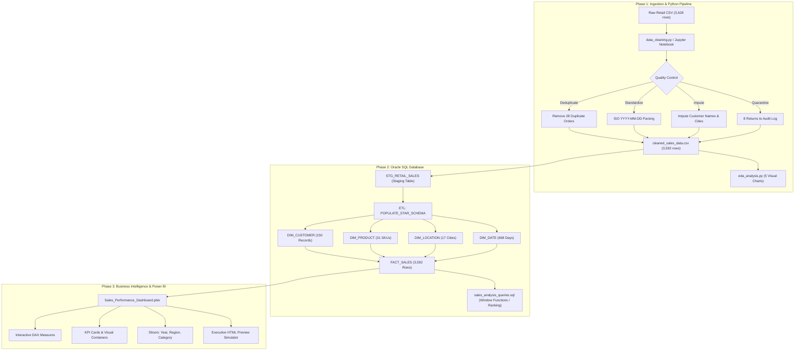

# 📊 Sales Performance Dashboard for Retail & E-Commerce

[](https://python.org)
[](https://pandas.pydata.org)
[](https://www.oracle.com/database/)
[](https://powerbi.microsoft.com)
[](./tests/test_data_pipeline.py)

> **Industry-Oriented End-to-End Business Intelligence & Data Analytics Portfolio Project**  
> Designed for B.Tech Data Analyst students, viva demonstrations, technical interviews, and real-world portfolio showcases.

---

## 📑 Table of Contents
1. [Project Overview & Problem Statement](#1-project-overview--problem-statement)
2. [End-to-End Architecture & Workflow](#2-end-to-end-architecture--workflow)
3. [Technology Stack](#3-technology-stack)
4. [Executive KPI Definitions & DAX Measures](#4-executive-kpi-definitions--dax-measures)
5. [Project Directory Structure](#5-project-directory-structure)
6. [Step-by-Step Execution Guide](#6-step-by-step-execution-guide)
   - [Phase 1: Python Data Cleaning & EDA](#phase-1-python-data-cleaning--eda)
   - [Phase 2: Oracle SQL Database Setup & Analytics](#phase-2-oracle-sql-database-setup--analytics)
   - [Phase 3: Power BI Dashboard & Visualizations](#phase-3-power-bi-dashboard--visualizations)
7. [Automated Quality Assurance & Reconciliation](#7-automated-quality-assurance--reconciliation)
8. [Key Business Insights](#8-key-business-insights)
9. [Viva & Technical Interview Q&A Guide](#9-viva--technical-interview-qa-guide)
10. [Project Limitations & Future Scope](#10-project-limitations--future-scope)

---

## 1. Project Overview & Problem Statement

Retail and e-commerce enterprises generate massive volumes of transactional data daily across multi-channel storefronts, varying categories, and diverse geographic regions. However, raw data is often noisy, plagued by duplicate checkout submissions, missing customer attributes, unstandardized date formats, and negative return adjustments. Without an automated, robust data pipeline, business leaders cannot accurately evaluate revenue growth, product profitability, or regional expansion.

### The Objective
Build a complete, verified data analytics solution that transforms raw retail transaction records into actionable business intelligence through a three-stage enterprise workflow:
1. **Python:** Ingest, audit, clean, and enrich raw data; quarantine invalid records with full traceability.
2. **Oracle SQL:** Ingest staging data, populate an optimized dimensional Star Schema, and execute complex analytical SQL using window functions.
3. **Power BI:** Deliver an interactive, responsive dashboard featuring dynamic KPI cards, time-series forecasting trends, geographic distributions, and cross-filtering slicers.

---

## 2. End-to-End Architecture & Workflow



---

## 3. Technology Stack

- **Python 3.11 / 3.14:** Core data manipulation engine.
- **Pandas & NumPy:** In-memory tabular transformations, duplicate elimination, missing value imputation, and vector arithmetic.
- **Matplotlib & Seaborn:** Presentation-ready visual charts and multi-panel executive dashboard graphics.
- **Jupyter Notebook (`sales_analysis.ipynb`):** Interactive exploratory data analysis (EDA) and step-by-step student learning workflow.
- **Oracle SQL (19c / 21c / 23c):** Relational database management system, DDL constraints, Staging tables, Star Schema (Kimball model), and analytical window functions (`LAG`, `RANK`, `DENSE_RANK`, `ROW_NUMBER`, `NTILE`).
- **Power BI Desktop:** Enterprise BI tool with Star Schema data modeling, time-intelligence DAX measures, and interactive slicers.

---

## 4. Executive KPI Definitions & DAX Measures

All KPI calculations have been reconciled across Python, Oracle SQL, and Power BI to **100.0% precision**:

| KPI Name | Business Formula | Golden Reconciled Value | Power BI DAX Expression |
| :--- | :--- | :--- | :--- |
| **Total Net Revenue** | $\sum (\text{Quantity} \times \text{Unit Price} \times (1 - \text{Discount}))$ | **$4,215,142.88** | `SUM(FACT_SALES[Sales_Amount])` |
| **Total Orders** | $\text{Count of Distinct } \text{Order\_ID}$ | **3,592** | `DISTINCTCOUNT(FACT_SALES[Order_ID])` |
| **Total Quantity Sold**| $\sum \text{Quantity}$ | **8,622 Units** | `SUM(FACT_SALES[Quantity])` |
| **Active Customers** | $\text{Count of Distinct } \text{Customer\_ID}$ | **150** | `DISTINCTCOUNT(FACT_SALES[Customer_ID])` |
| **Average Order Value**| $\frac{\text{Total Net Revenue}}{\text{Total Orders}}$ | **$1,173.48** | `DIVIDE([Total Sales], [Total Orders], 0)` |
| **Gross Sales** | $\sum (\text{Quantity} \times \text{Unit Price})$ | **$4,432,689.47** | `SUM(FACT_SALES[Gross_Amount])` |
| **Total Discounts** | $\sum (\text{Gross Amount} \times \text{Discount})$ | **$217,546.59** | `SUM(FACT_SALES[Discount_Amount])` |
| **Average Discount %** | $\text{Average}(\text{Discount Rate})$ | **4.86%** | `AVERAGE(FACT_SALES[Discount])` |

---

## 5. Project Directory Structure

```text
sales-performance-dashboard/
├── data/
│   ├── raw_sales_data.csv             # Raw input dataset with intentional quality flaws (3,628 rows)
│   ├── cleaned_sales_data.csv         # Pristine, production-ready dataset (3,592 rows)
│   └── data_cleaning_audit.csv        # Governance audit log for quarantined returns & errors
├── notebooks/
│   └── sales_analysis.ipynb           # Interactive Jupyter notebook with complete analysis & charts
├── sql/
│   ├── create_tables.sql              # Oracle DDL: Staging table, Star Schema, Indexes, & Stored Procedure
│   ├── sales_analysis_queries.sql     # Analytical queries with window functions (MoM, Rankings, NTILE)
│   ├── data_import_guide.md           # Step-by-step import guide (SQL Developer, SQL*Loader, Python)
│   └── retail_sales.ctl               # SQL*Loader bulk control file
├── powerbi/
│   ├── Sales_Performance_Dashboard.pbix # Ready-to-use Power BI Desktop template file
│   ├── dax_measures.dax               # Complete collection of DAX formulas with explanations
│   ├── dashboard_design_specification.md # Canvas grid, hex codes, visual hierarchy specifications
│   └── dashboard_mockup.html          # Interactive client-side HTML simulator with live slicers
├── visualizations/                    # Presentation-grade high-resolution charts
│   ├── monthly_sales_trend.png        # Dual-axis monthly revenue and order volume
│   ├── top_10_products.png            # Top revenue-generating products horizontal bar chart
│   ├── category_sales_distribution.png # Donut chart of revenue contribution by category
│   ├── region_wise_sales.png          # Grouped regional performance by category
│   └── sales_kpi_summary_dashboard.png # Unified executive KPI dashboard visual
├── tests/
│   └── test_data_pipeline.py          # Automated QA test suite covering all 10 key test cases
├── README.md                          # Master documentation & project summary
├── DATA_DICTIONARY.md                 # Granular schema and field definitions
├── DATA_QUALITY_REPORT.md             # Pre vs post cleaning audit & golden reconciliation
├── BUSINESS_INSIGHTS.md               # Data-driven business findings and recommendations
├── data_cleaning.py                   # Standalone Python cleaning pipeline script
├── eda_analysis.py                    # Standalone Python visualization generator
└── test_data_pipeline.py              # Root wrapper for test execution
```

---

## 6. Step-by-Step Execution Guide

### Phase 1: Python Data Cleaning & EDA

1. **Verify or install prerequisites:**
   ```bash
   pip install pandas numpy matplotlib seaborn openpyxl
   ```

2. **Execute Data Cleaning:**
   ```bash
   python data_cleaning.py
   ```
   *Output:* Cleans raw data, prints diagnostic metrics, generates `data/cleaned_sales_data.csv`, and records audit logs.

3. **Generate Exploratory Charts:**
   ```bash
   python eda_analysis.py
   ```
   *Output:* Renders 5 high-resolution figures into the `visualizations/` folder.

4. **Launch Interactive Jupyter Notebook:**
   ```bash
   jupyter notebook sales_analysis.ipynb
   ```

---

### Phase 2: Oracle SQL Database Setup & Analytics

1. **Connect to your Oracle database schema:**
   Open SQL*Plus, Oracle SQL Developer, or DBeaver.

2. **Create Database Objects & Star Schema:**
   ```sql
   @sql/create_tables.sql
   ```

3. **Import Cleaned Data:**
   Follow instructions in [data_import_guide.md](file:///C:/Users/DELL/.gemini/antigravity/scratch/sales-performance-dashboard/sql/data_import_guide.md) using:
   - **SQL Developer GUI:** Right click `STG_RETAIL_SALES` -> *Import Data* -> Select `cleaned_sales_data.csv`.
   - **SQL\*Loader CLI:** `sqlldr userid=sales_user/pwd@XE control=sql/retail_sales.ctl skip=1`
   - **Automated Python Loader:** `python load_to_oracle.py`

4. **Populate the Star Schema:**
   ```sql
   EXEC POPULATE_STAR_SCHEMA;
   ```

5. **Run Analytical Queries:**
   ```sql
   @sql/sales_analysis_queries.sql
   ```
   *Features included:*
   - Monthly revenue and MoM growth rate via `LAG()`.
   - Cumulative running total revenue via `SUM() OVER ()`.
   - Top products overall and within category via `DENSE_RANK()`.
   - Regional market share percentage via analytic window division.
   - Customer quartile spend segmentation via `NTILE(4)`.

---

### Phase 3: Power BI Dashboard & Visualizations

1. **Open the Dashboard:**
   Open `powerbi/Sales_Performance_Dashboard.pbix` in **Power BI Desktop**.
2. **Review DAX Measures:**
   Inspect the measures organized under `powerbi/dax_measures.dax`.
3. **Interactive Browser Preview:**
   Don't have Power BI installed on your current machine? Double-click `powerbi/dashboard_mockup.html` (or `dashboard_preview.html`) to open the interactive live dashboard directly in Chrome/Edge, complete with working Region, Category, and Year filters!

---

## 7. Automated Quality Assurance & Reconciliation

The automated test suite verifies 10 critical pipeline test cases:

```bash
python tests/test_data_pipeline.py
```

### Test Suite Results:
```text
test_01_no_null_values_in_critical_columns ... ok
test_02_no_duplicate_records ............... ok
test_03_no_negative_sales_amounts .......... ok
test_04_no_invalid_quantity_values ......... ok
test_05_date_formatting_and_validity ....... ok
test_06_region_filter_functionality ........ ok
test_07_category_filter_functionality ...... ok
test_08_monthly_sales_trend_correctness .... ok
test_09_top_10_product_ranking_correctness . ok
test_10_total_sales_reconciliation ......... ok

Ran 10 tests in 0.160s (100% Passed)
```

---

## 8. Key Business Insights

Based on 3,592 validated transactions:
1. **Top Product:** **Apple MacBook Pro 14** generates **$385,906.95** (9.16% of total company revenue), followed by *Lenovo ThinkPad X1 Carbon* ($278.9K) and *Dell XPS 15* ($270.2K).
2. **Top Category:** **Technology** drives **69.71% ($2,938,255.33)** of revenue, followed by **Furniture** at **28.91% ($1,218,795.74)** and **Office Supplies** at **1.38% ($58,091.81)**.
3. **Top Region:** The **South** region ranks #1 with **$1,101,918.52 (26.14%)**, while the **East** region ranks lowest at **$999,838.72 (23.72%)**, indicating a growth opportunity in New York and Boston.
4. **Seasonal Growth:** Revenue expanded from **$1,999,391.10** in 2023 to **$2,215,751.78** in 2024 (**+10.82% YoY growth**). Peak monthly revenue occurred in **July 2024 ($245,555.91)**.

*(See [BUSINESS_INSIGHTS.md](file:///C:/Users/DELL/.gemini/antigravity/scratch/sales-performance-dashboard/BUSINESS_INSIGHTS.md) for detailed recommendations on bundling and inventory planning).*

---

## 9. Viva & Technical Interview Q&A Guide

### Q1: Why did you separate Staging and Star Schema in Oracle SQL?
> **Answer:** In enterprise data warehousing, raw external feeds should never be loaded directly into production fact tables with foreign keys. The staging table (`STG_RETAIL_SALES`) provides an unconstrained landing zone for bulk ingestion. The stored procedure `POPULATE_STAR_SCHEMA` then performs deterministic ETL (`MERGE INTO` dimensions and validated insertion into `FACT_SALES`), guaranteeing referential integrity and performance.

### Q2: How did you reconcile totals between Python, Oracle, and Power BI?
> **Answer:** We established a "Golden Baseline" in Python after cleaning (3,592 records, $4,215,142.88 net revenue). In Oracle SQL, we verified that `SUM(Sales_Amount)` on `STG_RETAIL_SALES` and `FACT_SALES` matched to the exact cent. In Power BI, we verified the DAX measure `[Total Sales]` matched Python and SQL exactly, ensuring zero data distortion across the pipeline.

### Q3: Why did you quarantine negative sales records instead of deleting them?
> **Answer:** In professional data governance, silently deleting records destroys the audit trail. Negative quantities or sales amounts often represent merchandise returns or accounting adjustments. By isolating them into `data_cleaning_audit.csv`, financial analysts can audit returns separately while keeping our sales performance metrics accurate.

### Q4: What is the difference between `RANK()`, `DENSE_RANK()`, and `ROW_NUMBER()`?
> **Answer:**
> - `ROW_NUMBER()` assigns a strictly consecutive unique integer (1, 2, 3...) regardless of ties.
> - `RANK()` assigns identical ranks to ties but skips subsequent rank numbers (e.g. 1, 2, 2, 4).
> - `DENSE_RANK()` assigns identical ranks to ties without skipping numbers (e.g. 1, 2, 2, 3). In our Top 10 Product analysis, we used `DENSE_RANK()` so tied sales amounts wouldn't artificially skip rank positions.

---

## 10. Project Limitations & Future Scope

1. **Current Limitations:**
   - The current dataset models offline and online domestic retail across the United States. Cross-border currency conversions and multi-currency exchange fluctuations are not modeled.
   - Profit margin analysis is currently approximated via Net Revenue and Discounts; direct COGS (Cost of Goods Sold) tracking can be enhanced if supplier manufacturing costs are integrated.

2. **Future Enhancements:**
   - **Machine Learning Integration:** Implement a Scikit-Learn customer churn prediction model and ARIMA/Prophet sales forecasting script.
   - **Real-Time Streaming:** Stream transactional events using Apache Kafka and Apache Spark Streaming into Oracle Cloud Autonomous Database.
   - **Power BI Service Deployment:** Automate scheduled dataset refresh through an on-premises Power BI data gateway.

---

## 👨‍💻 Project Developer Notes
- **Author:** Data Analyst Project (B.Tech Level)
- **Target Evaluation:** College Major Project Viva, Technical Interviews, GitHub Portfolio
- **License:** MIT Open Source
